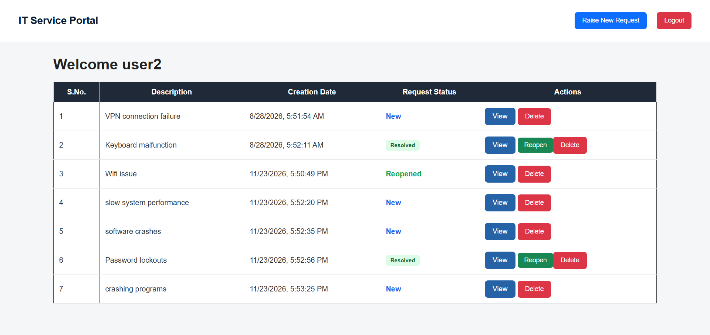
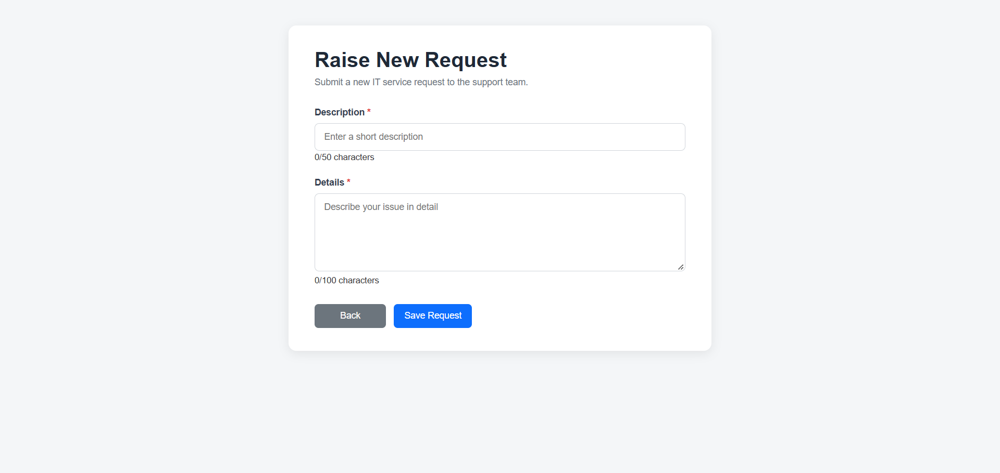
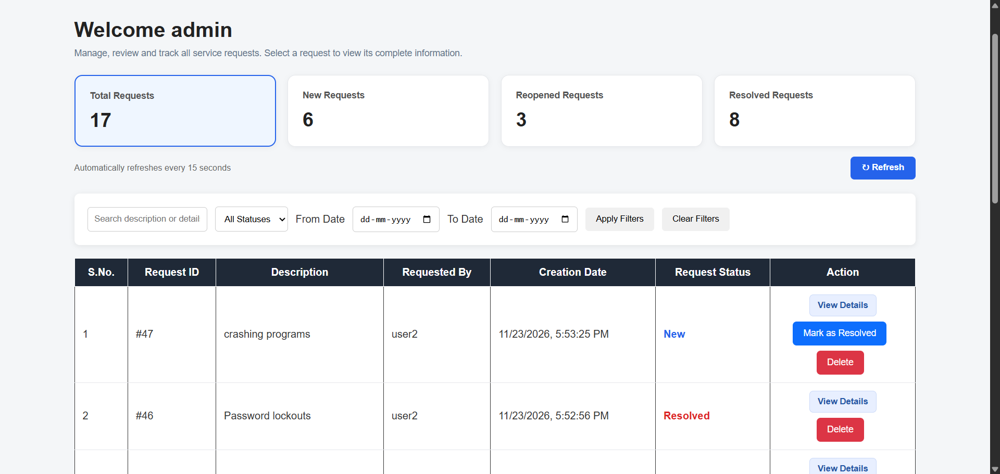
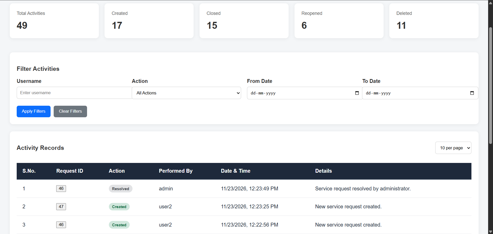
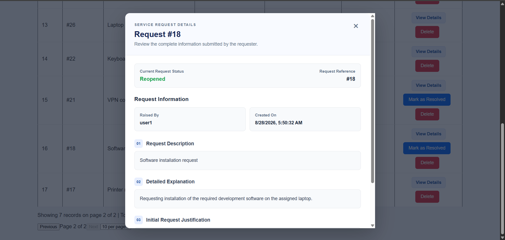
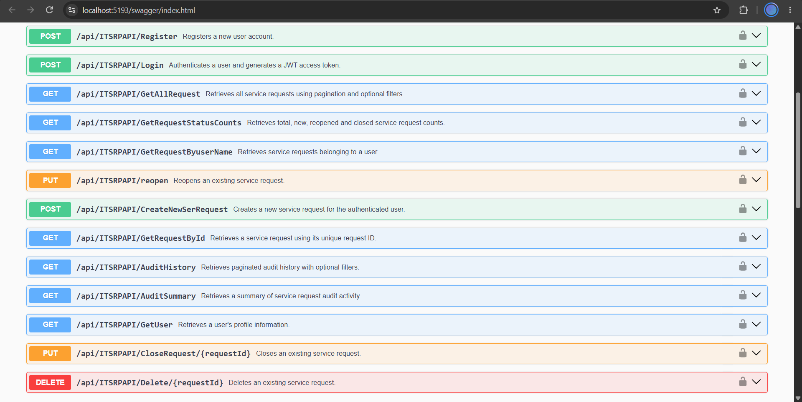

# IT Service Desk Management System

A full-stack IT support portal built with **ASP.NET Core .NET 10, React 19, Entity Framework Core, and Azure SQL**. It supports user registration, JWT authentication, role-based access, service request workflows, and administrative audit history.

## Live demo

- **React application:** https://proud-stone-0019ac600.4.azurestaticapps.net
- **ASP.NET Core API base URL:** https://servicedesk-api-neeraj-2026-fkgseadcemc2gpf0.centralindia-01.azurewebsites.net/api
- **GitHub repository:** https://github.com/Neeraj-pp/IT-Service-Desk-Management-System

The API is designed as a REST API, so opening its root URL may return HTTP 404. API routes are under **/api/ITSRPAPI**. Swagger is enabled for local Development, not Production. The hosted demo uses Azure free/shared tiers and may be temporarily unavailable if a platform quota is reached or the resources are stopped.

## Project overview

The application provides separate experiences for standard users and administrators.

- **Users** can register, sign in, raise support requests, view their own requests, and reopen eligible resolved requests.
- **Administrators** can review all requests, resolve requests, inspect request details, manage records, and view audit history.
- The API enforces authentication, role permissions, ownership checks, and request status transitions on the server.
- Passwords are hashed with ASP.NET Core Identity's PasswordHasher; passwords are not stored as plain text.

## Features

### Authentication and access control
- Public user registration and login.
- JWT Bearer authentication.
- Role-based authorization for **Admin** and **User**.
- Public registration assigns the standard **User** role.
- Production Admin provisioning through environment-based configuration, only when an Admin account does not already exist.

### Service request management
- Create and view service requests.
- Paginated request listing and filtering.
- Users can access their own requests; administrators can review all requests.
- Status lifecycle: **New → Resolved → Reopened**.
- Admins resolve requests; the original request owner can reopen an eligible resolved request once.
- Request deletion is protected by role and ownership checks.

### Audit history
- Records actions such as request creation, resolution, reopening, and deletion.
- Admin-only audit history and summary endpoints.
- Supports filtering and pagination.
- Audit records are retained independently of the service-request record.

## Technology stack

| Layer | Technologies |
|---|---|
| Backend API | C#, ASP.NET Core Web API, .NET 10 |
| Data access | Entity Framework Core 10, Repository pattern |
| Local database | SQLite |
| Deployed database | Azure SQL Database |
| SQL Server schema | Dedicated EF Core migrations project |
| Authentication | JWT Bearer authentication |
| Password security | ASP.NET Core Identity PasswordHasher |
| API documentation | Swagger / OpenAPI (Development) |
| Frontend | React 19, Vite 7, React Router 7 |
| HTTP client | Axios |
| Testing | xUnit, ASP.NET Core integration testing, Moq |
| Backend CI/CD | GitHub Actions, Azure Login OIDC, Azure App Service deployment |
| Frontend hosting and CI/CD | Azure Static Web Apps, GitHub Actions |

## Deployed architecture

The production frontend, API, and database are deployed as separate services.

~~~mermaid
flowchart TD
    B[User / Admin Browser]
    SWA[Azure Static Web Apps React + Vite]
    API[Azure App Service ASP.NET Core .NET 10 Web API]
    AUTH[JWT Authentication Role & ownership authorization]
    DAL[Repository + EF Core]
    SQL[(Azure SQL Database)]

    B -->|HTTPS| SWA
    SWA -->|Axios HTTPS requests JWT Bearer token| API
    API --> AUTH
    AUTH --> DAL
    DAL --> SQL
~~~

The React app is built with the production API base URL at build time using **VITE_API_BASE_URL**. The API CORS policy allows the deployed Static Web Apps origin.

For the infrastructure configuration, environment variables, deployment steps, and operational notes, see [Deployment Guide](docs/DEPLOYMENT.md).

## Repository structure

~~~text
IT-Service-Desk-Management-System/
├── .github/
│   └── workflows/
│       ├── azure-deploy.yml
│       └── azure-static-web-apps-proud-stone-0019ac600.yml
├── Capstone.API/
│   ├── Configuration/
│   ├── Controllers/
│   ├── DTOs/
│   ├── Middleware/
│   └── Services/
├── Capstone.DAL/
│   ├── Database/                    # Local SQLite database (not committed)
│   ├── Migrations/
│   ├── Model/
│   └── Repository/
├── Capstone.DAL.SqlServerMigrations/
│   └── Migrations/                  # SQL Server EF Core migrations
├── Capstone.React/
│   ├── public/
│   └── src/
│       ├── components/
│       ├── pages/
│       ├── services/
│       └── styles/
├── Capstone.Tests/
│   ├── ApiTests/
│   └── TestHelpers/
├── docs/
│   ├── DEPLOYMENT.md
│   └── PROOF-CAPTURE-CHECKLIST.md
├── screenshots/
└── CapstoneSolution.sln
~~~

## Architecture and request lifecycle

The React client calls the ASP.NET Core API through Axios. The API validates JWT bearer tokens and applies authorization rules before calling the repository. The repository uses Entity Framework Core to access the configured database. Audit events are handled by a dedicated audit service.

The local default database provider is SQLite. Production uses SQL Server through the **Database__Provider=SqlServer** setting and the **Capstone.DAL.SqlServerMigrations** migration assembly.

## API overview

Base route: **/api/ITSRPAPI**

| Method | Endpoint | Purpose / access |
|---|---|---|
| POST | /Register | Public registration; assigns the User role |
| POST | /Login | Public login; returns a JWT access token |
| GET | /GetAllRequest | Admin: paginated and filtered request list |
| GET | /GetRequestStatusCounts | Admin: request status summary |
| GET | /GetRequestByuserName | Retrieves requests subject to user/role checks |
| POST | /CreateNewSerRequest | Authenticated user: create a service request |
| GET | /GetRequestById | Retrieve a request subject to ownership/role checks |
| PUT | /reopen | Original request owner: reopen an eligible resolved request once |
| PUT | /CloseRequest/{requestId} | Admin: resolve a request |
| DELETE | /Delete/{requestId} | Delete own request; Admin can delete any request |
| GET | /AuditHistory | Admin: paginated and filtered audit history |
| GET | /AuditSummary | Admin: audit activity summary |
| GET | /GetUser | Retrieve profile subject to user/role checks |

Interactive request/response schemas are available through Swagger when running the API in Development.

## Run locally

### Prerequisites
- .NET 10 SDK
- Node.js and npm
- Git

### 1. Clone the repository

~~~bash
git clone https://github.com/Neeraj-pp/IT-Service-Desk-Management-System.git
cd IT-Service-Desk-Management-System
~~~

### 2. Configure the API

The committed **Capstone.API/appsettings.json** contains non-secret defaults. Configure the JWT signing key with .NET User Secrets for local development.

From the solution root:

~~~bash
dotnet user-secrets init --project Capstone.API
dotnet user-secrets set "Jwt:Key" "REPLACE_WITH_A_RANDOM_SECRET_OF_AT_LEAST_32_BYTES" --project Capstone.API
~~~

The API also expects:
- **Jwt:Issuer**
- **Jwt:Audience**
- **Jwt:AccessTokenMinutes** (5–120)

For Production, supply JWT values using hosting-provider environment variables such as **Jwt__Key**, **Jwt__Issuer**, and **Jwt__Audience**. Never commit secrets.

### 3. Apply local SQLite migrations

The local default provider is SQLite. From the solution root:

~~~bash
dotnet tool install --global dotnet-ef
dotnet ef database update --project Capstone.DAL --startup-project Capstone.API
~~~

The local database is configured under **Capstone.DAL/Database/ServiceDeskDB.db**. Database files are intentionally excluded from source control; migration source files are included.

### 4. Run the API

~~~bash
dotnet run --project Capstone.API
~~~

In Development, Swagger is available at the HTTPS URL shown by the launch profile (the local configured URL has been **https://localhost:5193/swagger**).

### 5. Run the React frontend

Open another terminal:

~~~bash
cd Capstone.React
npm ci
npm run dev
~~~

The frontend reads its API base URL from **VITE_API_BASE_URL**. For local development, set it to your local API base URL, for example **https://localhost:5193/api**. The API CORS origin must match the local Vite origin.

## SQL Server migrations

The SQL Server schema is maintained separately in **Capstone.DAL.SqlServerMigrations**, keeping the local SQLite design-time factory in **Capstone.DAL** separate.

The SQL Server design-time factory reads **AZURE_SQL_CONNECTION_STRING** from the environment. Set this variable securely before running EF Core migration commands for SQL Server. Never commit the connection string.

## Production Admin provisioning

On Production startup, **AdminSeeder** ensures the Admin and User roles and required request statuses exist. It creates an initial Admin only if an Admin account does not already exist.

If the database has no Admin, configure the initial credentials with:

~~~text
AdminSeed__UserName
AdminSeed__Password
~~~

The initial password must be at least 12 characters. It is hashed before storage. Keep these settings in the hosting provider's secret/environment configuration; never commit them. Once an Admin already exists, the seeder does not need the initial Admin credentials for subsequent startup.

## Automated tests

Run the test project from the solution root:

~~~bash
dotnet test Capstone.Tests/Capstone.Tests.csproj --configuration Release
~~~

The project includes repository tests and API integration tests for authentication, authorization, and request lifecycle behavior. The backend GitHub Actions workflow restores, tests, publishes, and deploys the API when relevant backend files change on **main**.

## CI/CD workflows

Two workflows are stored in **.github/workflows/**:

1. **azure-deploy.yml** — restores .NET dependencies, runs the API test project, publishes the API, uploads the published artifact, authenticates to Azure using GitHub OIDC, and deploys to Azure App Service. Deployment runs on pushes to **main** after the build/test job succeeds. Azure identifiers are stored as GitHub Actions repository secrets; no Azure client secret or publish profile is stored in the workflow.
2. **azure-static-web-apps-proud-stone-0019ac600.yml** — builds the Vite frontend and deploys the **dist** output to Azure Static Web Apps. The workflow injects **VITE_API_BASE_URL** at build time. The Static Web Apps deployment token is stored as a GitHub Actions secret.

See [Deployment Guide](docs/DEPLOYMENT.md) for the configuration and deployment flow. See [Proof Capture Checklist](docs/PROOF-CAPTURE-CHECKLIST.md) for recommended screenshots to retain in the repository.

## Screenshots

The screenshots below document the application's main user flows and administrative features.

### Login

### User dashboard

### Raise a service request

### Admin dashboard

### Audit history

### Request details

### API documentation

> Use demonstration data only in public screenshots. Do not publish real passwords, JWTs, cookies, connection strings, deployment tokens, personal information, or unredacted Azure configuration.

## Security and operations

- Never commit JWT signing keys, Admin seed credentials, SQL connection strings, database files, or local secrets.
- Use HTTPS for deployed environments.
- Keep CORS restricted to the exact deployed frontend origin.
- Use a strong, unique Production JWT signing key and Admin password.
- Review npm and NuGet dependency vulnerability reports.
- The App Service is on the F1 Free tier, which has strict CPU and bandwidth quotas. It is suitable for a learning/demo deployment, not a guaranteed-uptime production service. If a quota is exceeded, Azure can temporarily disable the app until the applicable quota reset.
- Azure resource availability and free-tier eligibility can change. Check the Azure portal's current quota and cost views before relying on the hosted demo.

## Possible future improvements

- Add a dedicated health-check endpoint and central structured monitoring.
- Expand frontend component tests and end-to-end browser tests.
- Add automated dependency/security scanning to CI.
- Improve accessibility and add richer operational dashboards.
