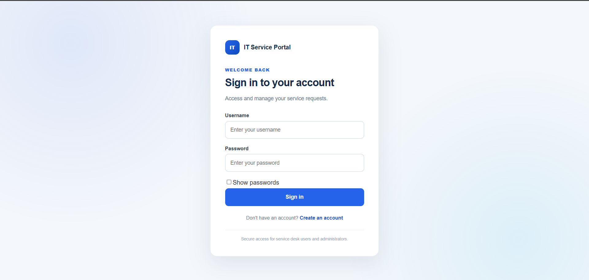
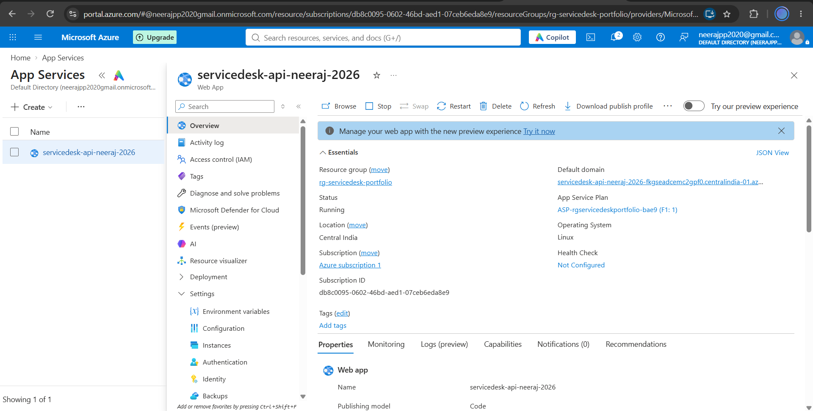
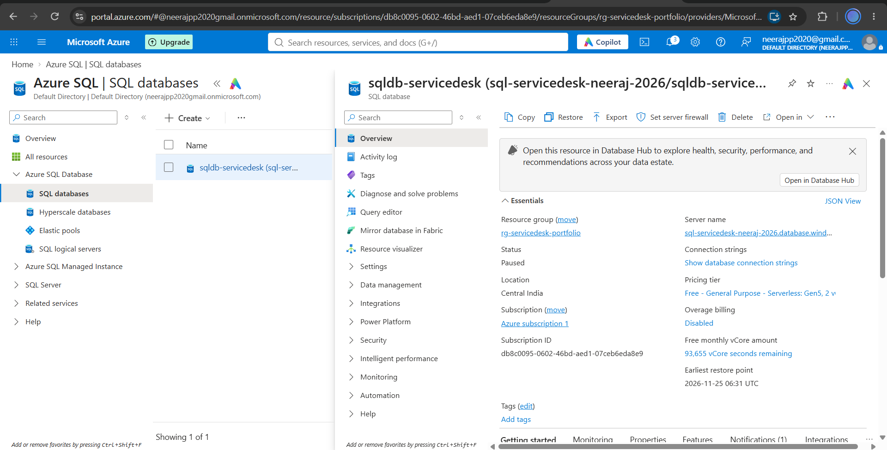
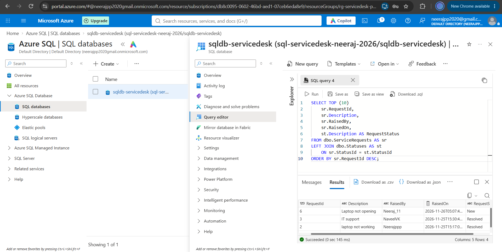

# IT Service Desk Management System

A **full-stack, cloud-deployed IT Service Desk Management System** built with **ASP.NET Core .NET 10, React 19, Entity Framework Core, and Azure SQL**. The application supports user registration and login, JWT authentication, role-based access, service request management, and administrative audit history.

## Live application

| Component | Deployment |
|---|---|
| **React frontend** | [Open IT Service Desk Portal](https://proud-stone-0019ac600.4.azurestaticapps.net) |
| **ASP.NET Core API** | [API base URL](https://servicedesk-api-neeraj-2026-fkgseadcemc2gpf0.centralindia-01.azurewebsites.net/api) |
| **GitHub repository** | [Neeraj-pp/IT-Service-Desk-Management-System](https://github.com/Neeraj-pp/IT-Service-Desk-Management-System) |

The frontend, API, and relational database are deployed as separate Azure services. Live registration, user login, Admin login, dashboard access, and data persistence in Azure SQL have been tested.

> **Demo availability:** The API is hosted on the Azure App Service F1 Free tier, which has strict resource quotas and no production availability SLA. The hosted demo can be temporarily unavailable if a quota is reached or Azure resources are stopped. The source code and local setup instructions remain available in this repository.

## Project overview

The system provides separate experiences for standard users and administrators.

- **Users** can register, sign in, raise support requests, view their own requests, and reopen eligible resolved requests.
- **Administrators** can review requests, resolve requests, inspect request details, manage records, and view audit history.
- The API enforces authentication, role permissions, ownership checks, and request status transitions on the server.
- Passwords are hashed with ASP.NET Core Identity's PasswordHasher; plain-text passwords are not stored.

## Key features

### Authentication and authorization
- Public user registration and login.
- JWT Bearer authentication.
- Role-based authorization for **Admin** and **User**.
- Public registration assigns the standard **User** role.
- Production Admin provisioning through environment-based credentials, only when an Admin account does not already exist.

### Service request management
- Create and view service requests.
- Paginated request listing and filtering.
- Users can access their own requests; administrators can review all requests.
- Request status lifecycle: **New → Resolved → Reopened**.
- Admins resolve requests; the original request owner can reopen an eligible resolved request once.
- Request deletion is protected by role and ownership checks.

### Audit history
- Records actions such as request creation, resolution, reopening, and deletion.
- Admin-only audit history and summary endpoints.
- Supports filtering and pagination.
- Audit records are retained independently of the service-request record.

## Technology stack

| Layer | Technologies |
|---|---|
| Backend API | C#, ASP.NET Core Web API, .NET 10 |
| Data access | Entity Framework Core 10, Repository pattern |
| Local database | SQLite |
| Deployed database | Azure SQL Database |
| SQL Server schema | Dedicated EF Core migrations project |
| Authentication | JWT Bearer authentication |
| Password security | ASP.NET Core Identity PasswordHasher |
| API documentation | Swagger / OpenAPI (Development) |
| Frontend | React 19, Vite 7, React Router 7 |
| HTTP client | Axios |
| Testing | xUnit, ASP.NET Core integration testing, Moq |
| Backend CI/CD | GitHub Actions, Azure Login OIDC, Azure App Service deployment |
| Frontend hosting and CI/CD | Azure Static Web Apps, GitHub Actions |

## Cloud architecture

The production frontend, API, and database are deployed independently on Azure.

~~~mermaid
flowchart TD
    B[User / Admin Browser]
    SWA[Azure Static Web Apps React + Vite]
    API[Azure App Service ASP.NET Core .NET 10 Web API]
    AUTH[JWT Authentication Role and ownership authorization]
    DAL[Repository + Entity Framework Core]
    SQL[(Azure SQL Database)]

    B -->|HTTPS| SWA
    SWA -->|Axios HTTPS requests JWT Bearer token| API
    API --> AUTH
    AUTH --> DAL
    DAL --> SQL
~~~

- Azure Static Web Apps hosts the React/Vite frontend.
- Azure App Service hosts the ASP.NET Core .NET 10 Web API.
- Azure SQL Database stores production users, roles, statuses, service requests, and audit records.
- Entity Framework Core uses a dedicated SQL Server migrations project for the deployed SQL Server schema.
- The frontend is built with the production API base URL using the Vite build-time variable **VITE_API_BASE_URL**.
- The API CORS configuration allows the deployed Static Web Apps origin.

See [docs/DEPLOYMENT.md](docs/DEPLOYMENT.md) for the Azure configuration, deployment process, and operational notes.

## Repository structure

~~~text
IT-Service-Desk-Management-System/
├── .github/
│   └── workflows/
│       ├── azure-deploy.yml
│       └── azure-static-web-apps-proud-stone-0019ac600.yml
├── Capstone.API/
│   ├── Configuration/
│   ├── Controllers/
│   ├── DTOs/
│   ├── Middleware/
│   └── Services/
├── Capstone.DAL/
│   ├── Database/                    # Local SQLite database (not committed)
│   ├── Migrations/
│   ├── Model/
│   └── Repository/
├── Capstone.DAL.SqlServerMigrations/
│   └── Migrations/                  # SQL Server EF Core migrations
├── Capstone.React/
│   ├── public/
│   └── src/
│       ├── components/
│       ├── pages/
│       ├── services/
│       └── styles/
├── Capstone.Tests/
│   ├── ApiTests/
│   └── TestHelpers/
├── docs/
│   ├── DEPLOYMENT.md
│   └── PROOF-CAPTURE-CHECKLIST.md
├── screenshots/
└── CapstoneSolution.sln
~~~

## API overview

Base route: **/api/ITSRPAPI**

| Method | Endpoint | Purpose / access |
|---|---|---|
| POST | /Register | Public registration; assigns the User role |
| POST | /Login | Public login; returns a JWT access token |
| GET | /GetAllRequest | Admin: paginated and filtered request list |
| GET | /GetRequestStatusCounts | Admin: request status summary |
| GET | /GetRequestByuserName | Retrieves requests subject to user/role checks |
| POST | /CreateNewSerRequest | Authenticated user: create a service request |
| GET | /GetRequestById | Retrieve a request subject to ownership/role checks |
| PUT | /reopen | Original request owner: reopen an eligible resolved request once |
| PUT | /CloseRequest/{requestId} | Admin: resolve a request |
| DELETE | /Delete/{requestId} | Delete own request; Admin can delete any request |
| GET | /AuditHistory | Admin: paginated and filtered audit history |
| GET | /AuditSummary | Admin: audit activity summary |
| GET | /GetUser | Retrieve profile subject to user/role checks |

Swagger is enabled when the API runs in Development. It is intentionally not exposed by the current Production configuration.

## CI/CD and deployment

Two GitHub Actions workflows automate the deployments.

### Backend workflow — Azure App Service

File: **.github/workflows/azure-deploy.yml**

1. Checks out the repository and installs the .NET 10 SDK.
2. Restores the backend test project.
3. Runs the automated tests with test-only JWT configuration.
4. Publishes the API and uploads the publish output as a workflow artifact.
5. Authenticates to Azure using GitHub OIDC.
6. Deploys the published API to Azure App Service.

The deployment job runs after the build/test job succeeds on pushes to **main**. The Azure deployment job uses a user-assigned managed identity with a federated credential. Azure identifiers are stored as GitHub Actions secrets; no long-lived Azure client secret or publish profile is stored in the workflow.

### Frontend workflow — Azure Static Web Apps

File: **.github/workflows/azure-static-web-apps-proud-stone-0019ac600.yml**

1. Checks out the repository.
2. Builds the React/Vite app from **Capstone.React**.
3. Injects **VITE_API_BASE_URL** at build time.
4. Publishes the **dist** output to Azure Static Web Apps.

The Static Web Apps deployment token is stored as an encrypted GitHub Actions repository secret. The frontend and API have separate workflows, so each can be deployed independently.

Workflow run evidence is included in the screenshots section below. For detailed configuration, see [docs/DEPLOYMENT.md](docs/DEPLOYMENT.md).

## Screenshots and deployment evidence

The repository includes screenshots of the original application UI and the deployed Azure solution. All images below are stored in the existing **screenshots/** folder.

### Application UI

| Screenshot | Description |
|---|---|
|  | Login page |
|  | User dashboard |
|  | Raise service request form |
|  | Admin dashboard |
|  | Audit history |
|  | Request details |
|  | Local Development Swagger/API documentation |

### Azure infrastructure and CI/CD proof

<strong>Azure resources and GitHub Actions evidence</strong>

**Azure Static Web Apps**

**Azure App Service (.NET 10)**

**Azure SQL Database resource**

**Backend GitHub Actions — build, test, publish, and deploy**

**Frontend GitHub Actions — build and deploy**

### Live application and database verification

<strong>Registration, dashboards, and Azure SQL evidence</strong>

**Live user registration**

**Live User dashboard**

**Live Admin dashboard**

**Azure SQL schema and tables**

**Azure SQL demo records**

> Screenshots use demonstration evidence. Never publish real passwords, password hashes, JWTs, cookies, connection strings, deployment tokens, personal information, or unredacted Azure configuration.

## Run locally

### Prerequisites
- .NET 10 SDK
- Node.js and npm
- Git

### 1. Clone the repository

~~~bash
git clone https://github.com/Neeraj-pp/IT-Service-Desk-Management-System.git
cd IT-Service-Desk-Management-System
~~~

### 2. Configure the API

The committed **Capstone.API/appsettings.json** contains non-secret defaults. Configure the JWT signing key with .NET User Secrets for local development.

From the solution root:

~~~bash
dotnet user-secrets init --project Capstone.API
dotnet user-secrets set "Jwt:Key" "REPLACE_WITH_A_RANDOM_SECRET_OF_AT_LEAST_32_BYTES" --project Capstone.API
~~~

The API also expects:
- **Jwt:Issuer**
- **Jwt:Audience**
- **Jwt:AccessTokenMinutes** (5–120)

For Production, supply JWT values using hosting-provider environment variables such as **Jwt__Key**, **Jwt__Issuer**, and **Jwt__Audience**. Never commit secrets.

### 3. Apply local SQLite migrations

The local default provider is SQLite. From the solution root:

~~~bash
dotnet tool install --global dotnet-ef
dotnet ef database update --project Capstone.DAL --startup-project Capstone.API
~~~

The local database is configured under **Capstone.DAL/Database/ServiceDeskDB.db**. Database files are intentionally excluded from source control; migration source files are included.

### 4. Run the API

~~~bash
dotnet run --project Capstone.API
~~~

In Development, Swagger is available at the HTTPS URL shown by the launch profile (the local configured URL has been **https://localhost:5193/swagger**).

### 5. Run the React frontend

Open another terminal:

~~~bash
cd Capstone.React
npm ci
npm run dev
~~~

The frontend reads its API base URL from **VITE_API_BASE_URL**. For local development, set it to your local API base URL, for example **https://localhost:5193/api**. The API CORS origin must match the local Vite origin.

## SQL Server migrations

The SQL Server schema is maintained separately in **Capstone.DAL.SqlServerMigrations**, keeping the local SQLite design-time factory in **Capstone.DAL** separate.

The SQL Server design-time factory reads **AZURE_SQL_CONNECTION_STRING** from the environment. Set this variable securely before running EF Core migration commands for SQL Server. Never commit the connection string.

## Production Admin provisioning

On Production startup, **AdminSeeder** ensures the Admin and User roles and required request statuses exist. It creates an initial Admin only if an Admin account does not already exist.

If the database has no Admin, configure the initial credentials with:

~~~text
AdminSeed__UserName
AdminSeed__Password
~~~

The initial password must be at least 12 characters. It is hashed before storage. Keep these settings in the hosting provider's secret/environment configuration; never commit them. Once an Admin already exists, the seeder does not need the initial Admin credentials for subsequent startup.

## Automated tests

Run the test project from the solution root:

~~~bash
dotnet test Capstone.Tests/Capstone.Tests.csproj --configuration Release
~~~

The project includes repository tests and API integration tests for authentication, authorization, and request lifecycle behavior. The backend GitHub Actions workflow restores, tests, publishes, and deploys the API on relevant pushes to **main**.

## Security and operations

- Never commit JWT signing keys, Admin seed credentials, SQL connection strings, database files, or local secrets.
- Use HTTPS for deployed environments.
- Keep CORS restricted to the exact deployed frontend origin.
- Use a strong, unique Production JWT signing key and Admin password.
- Review npm and NuGet dependency vulnerability reports.
- The App Service uses the F1 Free tier, which has strict CPU and bandwidth quotas. It is suitable for a learning/demo deployment, not a guaranteed-uptime production service. If a quota is exceeded, Azure can temporarily disable the app until the applicable quota reset.
- Azure resource availability and free-tier eligibility can change. Check Azure Cost Management and resource-specific quota views before relying on the hosted demo.

## Possible future improvements

- Add a dedicated health-check endpoint and centralized structured monitoring.
- Expand frontend component tests and end-to-end browser tests.
- Add automated dependency/security scanning to CI.
- Improve accessibility and add richer operational dashboards.
