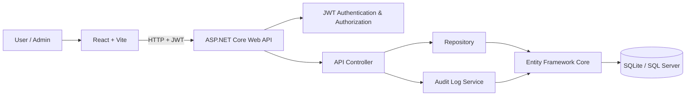

# IT Service Desk Management System

A full-stack service desk application for managing IT support requests, user accounts, request lifecycles, and administrative audit history. The solution uses an ASP.NET Core Web API, Entity Framework Core, SQLite, and a React frontend.

## Overview

The application provides separate experiences for standard users and administrators. Users can register, sign in, raise support requests, view and manage their own requests, and reopen eligible resolved requests. Administrators can review all requests, resolve requests, manage request records, and inspect audit activity.

## Technology stack

| Layer | Technologies |
|---|---|
| Backend API | C#, ASP.NET Core Web API, .NET 10 |
| Data access | Entity Framework Core 10, Repository pattern |
| Database | SQLite (configured to support SQL Server) |
| Authentication | JWT Bearer authentication |
| Password security | ASP.NET Core PasswordHasher |
| API documentation | Swagger / OpenAPI |
| Frontend | React 19, Vite, React Router |
| HTTP client | Axios |
| Testing | xUnit, ASP.NET Core integration testing, Moq |

## Features

### Authentication and access control
- User registration and login.
- JWT-based authentication.
- Role-based authorization for Admin and User roles.
- Password hashing using ASP.NET Core Identity's password hasher.
- Initial Admin provisioning in Production using environment-based credentials.
- Public registration assigns the User role; Admin creation is handled separately.

### Service request management
- Create and view service requests.
- Paginated request listing and filtering.
- User access is scoped to their own requests; administrators can review all requests.
- Status lifecycle:
  - **New**
  - **Resolved**
  - **Reopened**
- Backend-enforced lifecycle rules: Admins resolve requests; the original request owner may reopen an eligible resolved request once.
- Request deletion is role/ownership checked.

### Audit history
- Records actions such as request creation, resolution, reopening, and deletion.
- Admin-only audit history and summary endpoints.
- Supports filtering and pagination.
- Audit records are retained independently of the service-request record.

## Solution structure

```text
CapstoneProject/
├── Capstone.API/
│   ├── Configuration/
│   ├── Controllers/
│   ├── DTOs/
│   ├── Middleware/
│   └── Services/
├── Capstone.DAL/
│   ├── Migrations/
│   ├── Model/
│   └── Repository/
├── Capstone.React/
│   └── src/
│       ├── components/
│       ├── pages/
│       ├── services/
│       └── styles/
├── Capstone.Tests/
│   ├── ApiTests/
│   └── TestHelpers/
└── CapstoneSolution.sln
```

## Architecture

The React client communicates with the ASP.NET Core API over HTTP using Axios. The API validates JWT bearer tokens, applies authorization policies, and delegates data operations to the repository layer. The repository uses Entity Framework Core and the configured relational database. Audit logging is handled by a dedicated service.



## Getting started

### Prerequisites
- .NET 10 SDK
- Node.js and npm
- Git

### 1. Clone the repository

```bash
git clone https://github.com/Neeraj-pp/IT-Service-Desk-Management-System.git
cd IT-Service-Desk-Management-System
```

### 2. Configure the API

The committed `Capstone.API/appsettings.json` contains non-secret defaults. Configure the JWT signing key using .NET User Secrets for local development.

From the solution root:

```bash
dotnet user-secrets init --project Capstone.API
dotnet user-secrets set "Jwt:Key" "REPLACE_WITH_A_RANDOM_SECRET_OF_AT_LEAST_32_BYTES" --project Capstone.API
```

The API also expects:
- `Jwt:Issuer`
- `Jwt:Audience`
- `Jwt:AccessTokenMinutes` (5–120)

For Production, supply the JWT values using environment variables such as `Jwt__Key`, `Jwt__Issuer`, and `Jwt__Audience`. Do not commit secrets.

### 3. Apply database migrations

The current default provider is SQLite. From the solution root:

```bash
dotnet tool install --global dotnet-ef
dotnet ef database update --project Capstone.DAL --startup-project Capstone.API
```

The application is configured to use `Capstone.DAL/Database/ServiceDeskDB.db`. Database files are intentionally excluded from source control; migrations are included.

To use SQL Server instead, set `Database:Provider` to `SqlServer` and provide `ConnectionStrings:DefaultConnection` securely through configuration or environment variables.

### 4. Run the API

```bash
dotnet run --project Capstone.API
```

In Development, Swagger is available at:

```text
https://localhost:5193/swagger
```

The actual URL may differ according to your launch profile.

### 5. Run the React frontend

Open another terminal:

```bash
cd Capstone.React
npm install
npm run dev
```

The current API CORS policy is configured for the local frontend origin `http://localhost:64602`. If Vite selects a different port, update the API's CORS origin and the frontend API base URL accordingly.

## Production Admin provisioning

On Production startup, `AdminSeeder` ensures the Admin role exists and creates an initial Admin only when one does not already exist. Supply the initial credentials as environment variables:

```text
AdminSeed__UserName
AdminSeed__Password
```

The initial password must be at least 12 characters. The password is hashed before it is stored. The seeder does not create duplicate Admin accounts on subsequent starts. Keep these values in your hosting provider's secret/environment configuration; never commit them.

## Tests

Run the automated test suite from the solution root:

```bash
dotnet test CapstoneSolution.sln
```

The test project includes repository tests and API integration tests for authentication and request lifecycle/authorization behavior.

## Security notes

- Never commit JWT signing keys, Admin seed credentials, database files, or local secrets.
- Use HTTPS in deployed environments.
- Update CORS to the exact deployed frontend origin.
- Use a strong, unique Production JWT signing key and Admin password.
- Review dependency vulnerability reports regularly.

## Screenshots

Application screenshots will be added here after upload.

Suggested images:
- Login page
- User dashboard with request list
- Raise request form
- Request details view
- Admin dashboard and request filters
- Audit history page
- Swagger authentication/API view (optional)

Use sanitized demo data only. Do not include real usernames, email addresses, passwords, JWTs, database contents, or personal information.

## Future enhancements

- Deployment configuration and hosted demo.
- CI pipeline for automated build and tests.
- Additional observability and structured logging.
- Expanded API and UI test coverage.
