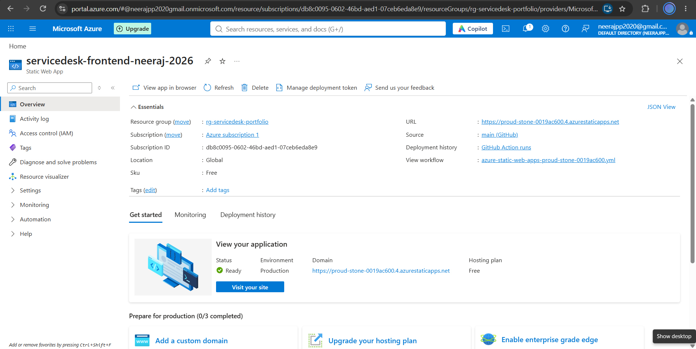
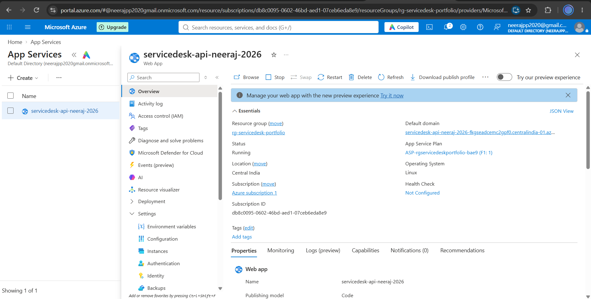
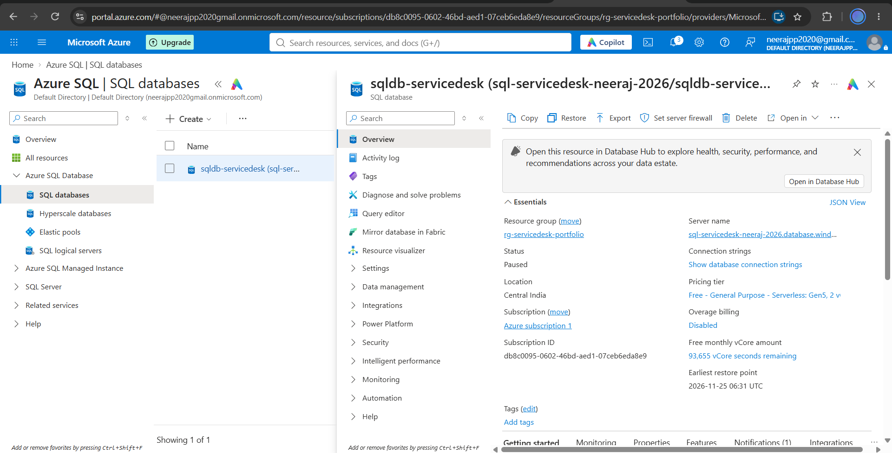
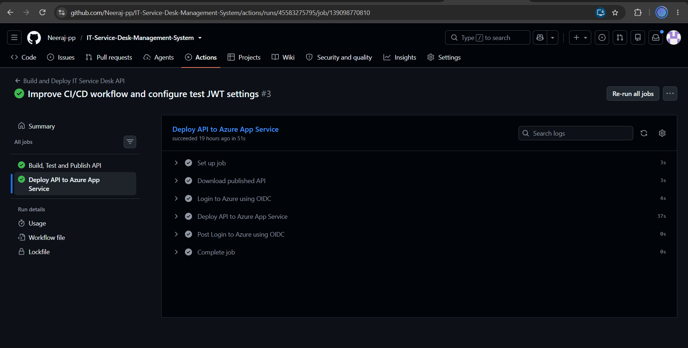
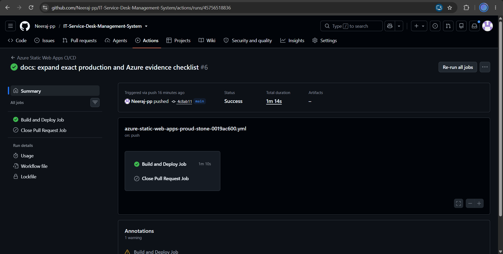
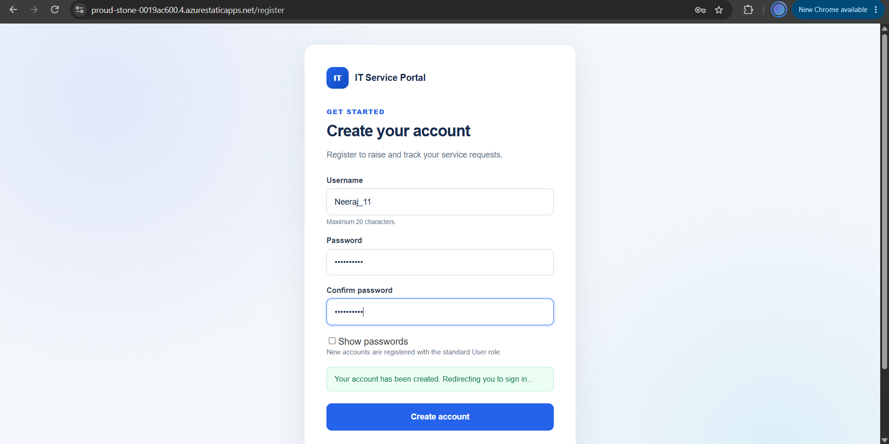
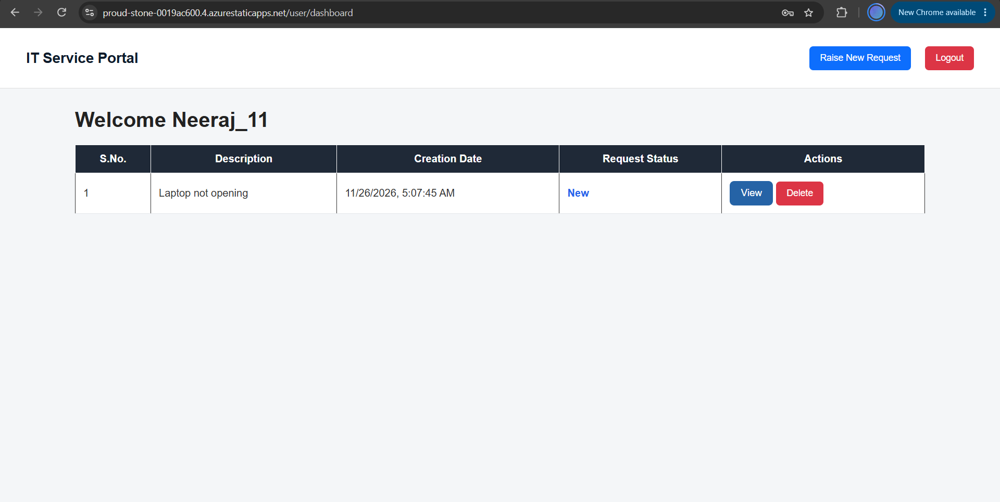
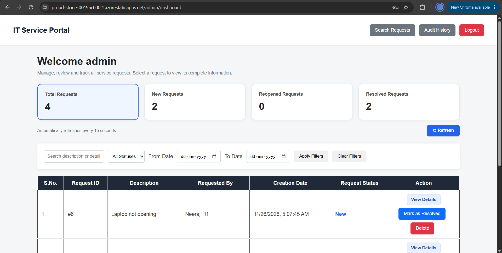
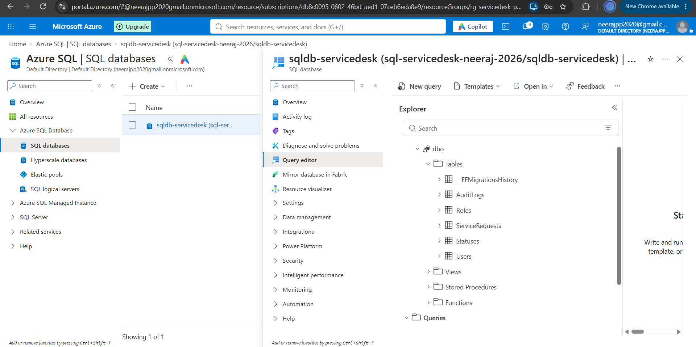
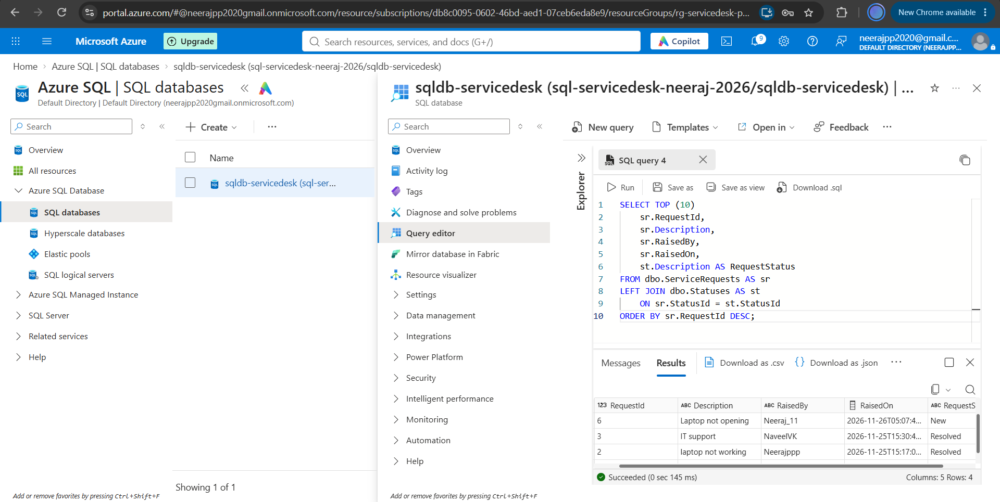

# Azure Deployment Guide

This guide documents the deployed hosting layout, GitHub Actions workflows, and verification evidence for the IT Service Desk Management System.

## Live endpoints

| Component | Current deployment |
|---|---|
| React frontend | https://proud-stone-0019ac600.4.azurestaticapps.net |
| API base URL | https://servicedesk-api-neeraj-2026-fkgseadcemc2gpf0.centralindia-01.azurewebsites.net/api |
| API route prefix | /api/ITSRPAPI |
| Azure resource group | rg-servicedesk-portfolio |
| App Service | servicedesk-api-neeraj-2026 |
| Static Web App | proud-stone-0019ac600 |
| SQL logical server | sql-servicedesk-neeraj-2026 |
| SQL database | sqldb-servicedesk |

The live frontend uses the deployed API URL. Registration, login, User/Admin dashboard access, and Azure SQL data persistence have been tested. The hosted resources use learning/free tiers and may be unavailable if a platform quota is reached, a subscription is disabled, or resources are stopped. This is a portfolio/demo deployment, not an uptime guarantee.

## Production architecture

~~~mermaid
flowchart TD
    Browser[User / Admin Browser]
    Frontend[Azure Static Web Apps React + Vite]
    Backend[Azure App Service Linux, ASP.NET Core .NET 10]
    Auth[JWT validation Role and ownership checks]
    Data[Repository + Entity Framework Core]
    Database[(Azure SQL Database)]

    Browser -->|HTTPS| Frontend
    Frontend -->|Axios + HTTPS + JWT| Backend
    Backend --> Auth
    Auth --> Data
    Data --> Database
~~~

The frontend and API are separate deployments. The API connects to Azure SQL with a dedicated SQL application login rather than the SQL Server administrator login.

## Azure resources and configuration

### Static Web Apps

- Hosts the React/Vite frontend.
- Source repository: Neeraj-pp/IT-Service-Desk-Management-System.
- Branch: main.
- App location: Capstone.React.
- API location: empty; the API is hosted separately.
- Output location: dist.
- The workflow injects VITE_API_BASE_URL during the frontend build.
- The repository includes Capstone.React/public/staticwebapp.config.json to route React Router paths back to index.html.

### App Service

The API App Service uses the Linux .NET 10 runtime and the F1 Free App Service plan.

Application settings are configured in **App Service → Settings → Environment variables**. Important keys:

| App setting | Purpose |
|---|---|
| ASPNETCORE_ENVIRONMENT | Production |
| Database__Provider | SqlServer |
| ConnectionStrings__DefaultConnection | Azure SQL connection string; keep its value secret |
| Jwt__Issuer | JWT issuer |
| Jwt__Audience | JWT audience |
| Jwt__Key | Production JWT signing key (secret, at least 32 bytes) |
| Jwt__AccessTokenMinutes | Token lifetime; application validates 5–120 minutes |
| Frontend__AllowedOrigin | Exact Static Web Apps origin, without a trailing slash |

If the database has not yet been seeded with an Admin account, configure AdminSeed__UserName and AdminSeed__Password securely for first-time provisioning. Do not place these values in source control or public documentation. The seeder checks for an existing Admin before requiring these values on later starts.

### CORS

The production Frontend__AllowedOrigin is configured to match the Static Web Apps origin:

~~~text
https://proud-stone-0019ac600.4.azurestaticapps.net
~~~

If the Static Web Apps hostname changes, update the API's Frontend__AllowedOrigin setting and save/apply the App Service configuration.

### Azure SQL

Production database configuration uses:

- Provider: SQL Server
- Database: sqldb-servicedesk
- SQL logical server: sql-servicedesk-neeraj-2026
- Server FQDN: sql-servicedesk-neeraj-2026.database.windows.net
- Port: 1433
- Application login: servicedesk_app

The actual password and full connection string must remain in Azure App Service configuration and must never be committed.

The deployed SQL schema is managed by EF Core migrations in Capstone.DAL.SqlServerMigrations. The migration history is recorded in __EFMigrationsHistory. The production schema contains the application tables for users, roles, statuses, service requests, and audit logs.

## GitHub Actions CI/CD

The repository contains two independent workflows.

### Backend: .github/workflows/azure-deploy.yml

The backend workflow:

1. Checks out the repository.
2. Installs the .NET 10 SDK.
3. Restores Capstone.Tests/Capstone.Tests.csproj.
4. Runs the automated test project using test-only JWT settings.
5. Publishes Capstone.API in Release configuration.
6. Uploads the published API as a workflow artifact.
7. Uses azure/login with OIDC to authenticate to Azure.
8. Deploys the artifact to the servicedesk-api-neeraj-2026 App Service.

The deployment job runs only for pushes to main after the build-and-test job succeeds. Pull requests can run build/tests but do not deploy.

The GitHub repository uses encrypted Actions secrets for:
- AZURE_CLIENT_ID
- AZURE_TENANT_ID
- AZURE_SUBSCRIPTION_ID

The workflow requests id-token: write only in the deployment job. Azure trusts the GitHub branch identity through a federated credential on a user-assigned managed identity. No long-lived Azure client secret or publish profile is stored in the workflow.

### Frontend: .github/workflows/azure-static-web-apps-proud-stone-0019ac600.yml

The frontend workflow uses the Azure Static Web Apps deployment action.

| Setting | Value |
|---|---|
| App location | ./Capstone.React |
| API location | Empty; API is hosted separately |
| Output location | dist |
| Build command | npm run build, detected by Oryx from package.json |
| Vite API variable | VITE_API_BASE_URL |

The workflow injects the production API base URL during the Vite build. Vite environment variables prefixed with VITE_ are included in the browser bundle and must never contain secrets. The Static Web Apps deployment token is stored in a GitHub Actions secret.

## Deployment and functional verification evidence

The repository stores the actual Azure and GitHub Actions screenshots in screenshots/.

| Evidence | Screenshot |
|---|---|
| Static Web App resource | screenshots/08-azure-static-web-app-overview.png |
| App Service runtime and status | screenshots/09-azure-app-service-overview.png |
| Azure SQL database resource | screenshots/10-azure-sql-database-overview.png |
| Backend build/test/deploy workflow | screenshots/11-github-api-actions-success.png |
| Frontend build/deploy workflow | screenshots/12-github-frontend-actions-success.png |
| Successful live registration | screenshots/13-live-user-registration.png |
| Azure SQL demo records | screenshots/14-azure-sql-demo-records.png |
| Live User dashboard | screenshots/14-live-user-dashboard.png |
| Live Admin dashboard | screenshots/15-live-admin-dashboard.png |
| Azure SQL schema and tables | screenshots/16-azure-sql-schema-tables.png |

The screenshots are evidence captured from the deployed project. Do not infer guaranteed uptime from a successful deployment screenshot; App Service F1 has strict quotas and no production SLA.

## Frontend routing

The React application uses BrowserRouter. The file Capstone.React/public/staticwebapp.config.json configures a navigation fallback to /index.html, allowing direct links and browser refreshes to be handled by React Router.

## Local build commands

From the repository root:

~~~bash
dotnet restore Capstone.Tests/Capstone.Tests.csproj
dotnet test Capstone.Tests/Capstone.Tests.csproj --configuration Release
dotnet publish Capstone.API/Capstone.API.csproj --configuration Release --output ./publish
~~~

For the frontend:

~~~bash
cd Capstone.React
npm ci
npm run build
~~~

The frontend build output is Capstone.React/dist.

## API smoke test

The API login route is:

~~~text
POST https://servicedesk-api-neeraj-2026-fkgseadcemc2gpf0.centralindia-01.azurewebsites.net/api/ITSRPAPI/Login
~~~

A deliberate invalid-credentials test previously returned HTTP 401 from Kestrel. This confirmed the API route was responding and rejecting the supplied invalid credentials; it was not a successful login test. Successful login and registration were then tested through the live React application.

Never place a real account password or JWT into shell history, a screenshot, an issue, or a public commit.

## F1 Free plan operational note

The API App Service currently uses the F1 Free tier. It has strict CPU and outbound data quotas, and it does not provide a production availability SLA. During deployment troubleshooting, the site entered QuotaExceeded state and returned 503 responses. After the quota state returned to Normal, the application became reachable again. A SQL server hostname typo in the App Service connection string was also identified and corrected during startup troubleshooting.

Useful checks from Azure Cloud Shell:

~~~bash
az webapp show \
  --name servicedesk-api-neeraj-2026 \
  --resource-group rg-servicedesk-portfolio \
  --query "{State:state, UsageState:usageState, Availability:availabilityState}" \
  --output yaml
~~~

Do not assume that all Azure services are free because one resource is on a Free tier. Review Cost Management, resource-specific quotas, and subscription offer terms regularly. If the hosted demo is unavailable, the GitHub source and local run instructions remain the reproducible fallback.

## Secret handling

Never commit or publish:
- the full SQL connection string or SQL application password;
- the Production JWT signing key;
- Admin seed credentials;
- the Azure Static Web Apps deployment token;
- GitHub Actions secret values, cookies, or access tokens;
- user password hashes from the Users table.

Use Azure App Service environment settings for runtime secrets and GitHub Actions encrypted secrets for deployment authentication.

## Verified GitHub Actions run references

The following links identify completed deployment runs that were checked directly in GitHub Actions:

| Component | Run | Result | What the run established |
|---|---|---|---|
| Backend API | [Run #3 — Build and Deploy IT Service Desk API](https://github.com/Neeraj-pp/IT-Service-Desk-Management-System/actions/runs/45583275795) | **Success** | Build, automated tests, Release publish, artifact upload, Azure OIDC login, and App Service deployment all completed successfully. |
| React frontend | [Run #10 — Azure Static Web Apps CI/CD](https://github.com/Neeraj-pp/IT-Service-Desk-Management-System/actions/runs/45761022603) | **Success** | React build and Azure Static Web Apps deployment completed successfully. |

A later frontend run, [Run #11](https://github.com/Neeraj-pp/IT-Service-Desk-Management-System/actions/runs/45761027414), built the React application successfully and uploaded the deployment artifact, but Azure reported **Deployment Canceled** during the deployment polling stage. This later run is not a successful deployment and must not be used as the green frontend deployment proof. The preceding successful Run #10 remains the verifiable successful deployment run. Check the Actions page for the newest status before presenting the repository as having a currently green pipeline.

## Inline deployment evidence

These are the repository's committed deployment proof images. Open each image in GitHub to inspect its complete contents.

### Azure hosting resources

**Azure Static Web Apps resource**

**Azure App Service hosting the ASP.NET Core API**

**Azure SQL Database resource**

### CI/CD deployment runs

**Backend — GitHub Actions build, test, publish, and Azure deployment**

**Frontend — GitHub Actions build and Azure Static Web Apps deployment**

The screenshots above are historical evidence captured for the successful runs. Their filenames do not prove that the newest workflow run is green; use the linked run pages for exact run status.

### Live application and database verification

**Live registration**

**Live User dashboard**

**Live Admin dashboard**

**Azure SQL schema and tables**

**Azure SQL persisted demo records**

### Evidence interpretation

- Azure resource screenshots demonstrate that the named hosting/database resources were provisioned.
- Successful workflow screenshots and run links demonstrate the CI/CD deployment process completing at the time of those runs.
- Live registration and dashboard screenshots demonstrate the deployed application's user-facing flows.
- SQL schema and demo-record screenshots demonstrate the database structure and example persisted records.
- These images are not a substitute for a current health check and do not guarantee future availability. The App Service F1 Free tier has strict quotas and no production availability SLA.
